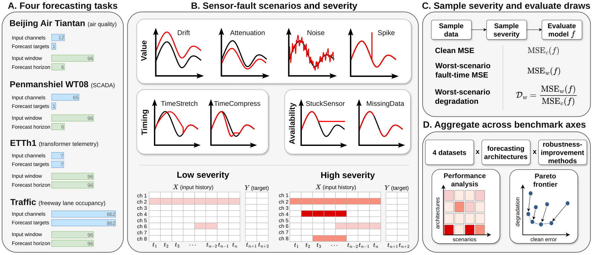
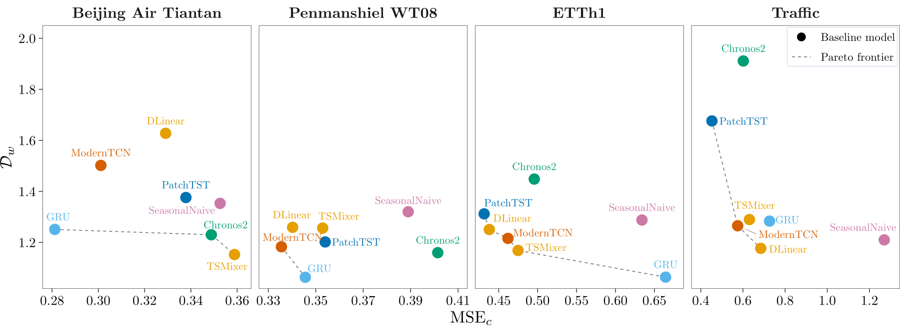
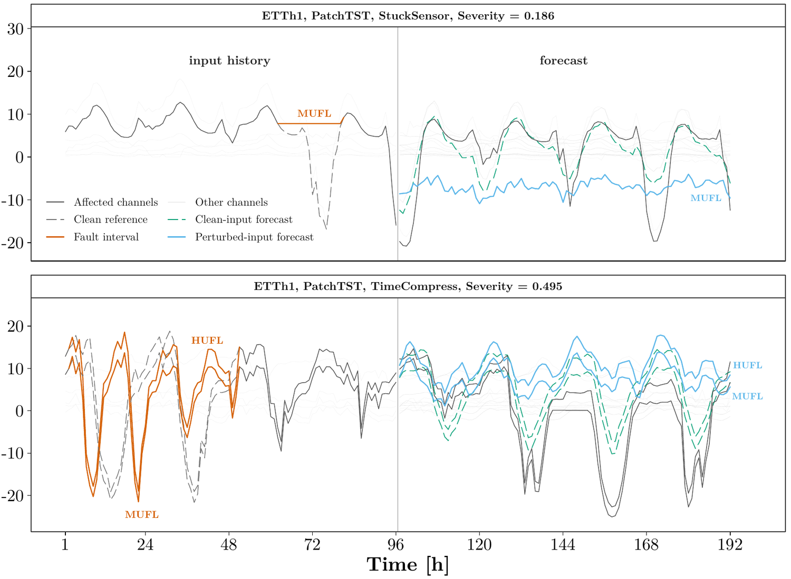

<h1 align="center">SensorFault-Bench</h1>

<p align="center"><b>Benchmarking Sensor-Fault Robustness in Forecasting</b><br>
NeurIPS 2026 · Evaluations &amp; Datasets Track</p>

<p align="center">
<a href="https://neurips.cc/virtual/2026/loc/paris/poster/138912"></a>
<a href="CHANGELOG.md"></a>
<a href="LICENSE"></a>

<a href="https://github.com/awindmann/SensorFault-Bench/actions/workflows/tests.yml"></a>
</p>

<p align="center">Alexander Windmann¹ · Philipp Wittenberg¹ · Gianluca Manca² · Marcel Dix³ · Jens U. Brandt⁴˒⁵ · Oliver Niggemann¹<br>
<sub>¹Helmut Schmidt University · ²Ruhr University Bochum · ³ABB Corporate Research · ⁴TH Köln · ⁵Leiden University</sub></p>

<p align="center"><sub>4 datasets · 8 sensor-fault scenarios · 7 forecasting architectures · 7 robustness-improvement methods</sub></p>

<p align="center">
<a href="#start-here">Start here</a> ·
<a href="#what-the-benchmark-measures">Benchmark</a> ·
<a href="#key-findings">Findings</a> ·
<a href="#fault-scenarios">Scenarios</a> ·
<a href="#installation">Installation</a> ·
<a href="#quick-start">Quick start</a> ·
<a href="#reproducing-the-paper">Reproduction</a> ·
<a href="#results-of-the-default-configuration">Results</a> ·
<a href="#evaluating-a-new-model-or-method">Evaluate your model</a> ·
<a href="#using-the-fault-operators-outside-the-benchmark">Fault operators</a> ·
<a href="#citation">Citation</a>
</p>

**TL;DR.** SensorFault-Bench tests how forecasting models for cyber-physical
systems (CPS) behave when their sensors fail. It injects eight controlled value,
timing, and availability faults into real input histories, keeps the forecast
targets fixed, and reports worst-scenario degradation next to clean and
worst-scenario fault-time mean squared error (MSE). Forecasting architectures
favored by clean MSE can degrade sharply under faults.

<p align="center">

</p>

<sub>The benchmark perturbs observed input histories while keeping forecast
targets fixed. The scored set contains eight value, timing, and availability
scenarios on one severity axis. Panels A to C show the task scope, the scenario
suite, and the flow from sampling to scores. Panel D aggregates results across
datasets, architectures, methods, and scenarios into views of clean error and
degradation.</sub>

## Start here

| Goal | Start with |
| --- | --- |
| Understand what the benchmark measures | [What the benchmark measures](#what-the-benchmark-measures) and the [benchmark protocol](docs/benchmark_protocol.md) |
| Try the benchmark on a CPU | [Quick start](#quick-start) or the [tutorial notebook](notebooks/tutorial/quickstart.ipynb) |
| Download and validate the four datasets | [Data guide](data/README.md) |
| Run the full workflow or look up command-line options | [Reproducing the benchmark](docs/reproducing_benchmark.md) |
| Reproduce the paper | [Reproducing the paper](#reproducing-the-paper), the [paper artifact](paper_artifact/README.md), and its [figure scripts](paper_artifact/R/README.md) |
| Rerun the sensitivity analyses of the paper | [Sensitivity analyses](docs/sensitivity_analyses.md) |
| Plot forecasts for single test windows | [Forecast plot replay](docs/forecast_plot_replay.md) |
| Evaluate a new forecasting architecture | [Extending models](docs/extending_models.md), then [Evaluating a new model or method](#evaluating-a-new-model-or-method) |
| Evaluate a model trained elsewhere | [Models trained elsewhere](docs/extending_models.md#models-trained-elsewhere) |
| Evaluate a new robustness-improvement method | [Extending methods](docs/extending_methods.md), then [Evaluating a new model or method](#evaluating-a-new-model-or-method) |
| Apply the protocol to your own data | [Extending datasets](docs/extending_datasets.md) |
| Pretrain, augment, or stress-test with the fault operators | [Using the fault operators](docs/using_fault_operators.md) |
| Report a result | [Reporting results](docs/benchmark_protocol.md#reporting-results) |

## What the benchmark measures

- **Faults act on inputs only.** Each scenario corrupts the observed input
  history. The forecast target stays the recorded future, so the correct
  forecast does not change.
- **One severity axis.** Severity $s \in [0, 1]$ sets the fault magnitude of
  every scenario, and each test window draws its severity uniformly. Scenarios
  scoped to channels perturb a subset of continuous channels that grows with
  severity, up to half of the eligible channels.
- **Three reported quantities.** Relative robustness and absolute error are
  reported separately:

  | Quantity | Definition |
  | --- | --- |
  | Clean error $\mathrm{MSE}_c$ | Test MSE on unperturbed input histories |
  | Worst-scenario fault-time error $\mathrm{MSE}_w$ | Largest $\mathrm{MSE}_p$ over the eight scenarios, where $\mathrm{MSE}_p$ is the test MSE under scenario $p$ averaged over sampled severities |
  | Worst-scenario degradation $\mathcal{D}_w$ | $\mathrm{MSE}_w / \mathrm{MSE}_c$, the largest scenario degradation $\mathcal{D}_p = \mathrm{MSE}_p / \mathrm{MSE}_c$ |

- **Paired method comparisons.** Each robustness-improvement method is compared
  with the baseline forecasting model of the same dataset and architecture.
  Method results are mean paired deltas over the method-comparison
  architectures.
- **Disjoint transfer split.** Fault augmentation trains on seven
  training-only transfer fault families that never enter scoring, so its
  results measure transfer to the scored scenarios.
- **Selection on clean validation data.** Every architecture and
  robustness-improvement method receives its own hyperparameter search under
  the same budget. Because each search selects on clean validation data only,
  test data serves reporting alone.

The [benchmark protocol](docs/benchmark_protocol.md) defines each part and
links it to its implementation.

## Key findings

<!-- key-findings:start -->
1. **Low clean error does not imply robustness.** Forecasting architectures favored by clean MSE can degrade sharply under faults. On Traffic, PatchTST has the lowest clean MSE (0.453) and the second-largest worst-scenario degradation (1.676). The architectures with the lowest clean MSE and the lowest worst-scenario fault-time MSE differ on three of the four datasets.
2. **Chronos-2 has either high clean error or low robustness on each dataset.** Chronos-2 is a pretrained time series foundation model that the benchmark runs zero-shot, without fine-tuning on the four datasets. On the two single-target datasets, its worst-scenario degradation is the second lowest, but its clean MSE matches or trails that of the last-value naive forecaster, which repeats the last observed value (0.349 against 0.353 on Beijing Air Tiantan and 0.401 against 0.389 on Penmanshiel WT08). On ETTh1 and Traffic, where all channels are forecast targets, Chronos-2 has the largest worst-scenario degradation of the seven architectures (1.448 and 1.911).
3. **Robustness-improvement methods help selectively.** Paired deltas against the baseline forecasting model of the same architecture show selective degradation reductions. PGD adversarial training leads on Penmanshiel WT08 (-0.059) and randomized training on Beijing Air Tiantan (-0.146), where value faults dominate observed degradation. Fault augmentation leads on Traffic (-0.025), where availability faults dominate. Values are mean paired changes in worst-scenario degradation over the five method-comparison architectures.
<!-- key-findings:end -->

The [paper](https://neurips.cc/virtual/2026/loc/paris/poster/138912)
discusses these findings in Section 6. The numbers come from the
[results of the default configuration](#results-of-the-default-configuration)
below.

<p align="center">

</p>

<sub>Clean MSE against worst-scenario degradation for the baseline forecasting
architectures within each dataset. Lower is better on both axes, and the dashed
line connects the Pareto frontier.</sub>

## Fault scenarios

The scored set contains eight scenarios in three classes, with membership and
order fixed by `PERTURBATION_SCENARIOS` in
[`configs/defaults.yaml`](configs/defaults.yaml) and the operators implemented
in [`data/perturbations.py`](data/perturbations.py). Value perturbations act on
inputs standardized with training statistics, so offsets, noise levels, and
spike magnitudes are in standard deviations of the affected channel. For each
scenario, the severity range gives the fault quantity at $s = 0$ and $s = 1$.
Table 7 of the paper links each scenario to sensor faults documented in prior
studies and separates their reported scales from the standardized settings
below.

| Class | Scenario | Standardized construction | Severity range | Channels | Modeled fault |
| --- | --- | --- | --- | --- | --- |
| Value | Drift (`drift`) | Positive constant offset over the history of each selected channel | offset in standard deviations, 0 to 0.75 | continuous subset | constant sensor bias |
| Value | Attenuation (`attenuation`) | Multiplication of each selected channel by a decreasing factor | amplitude factor, 1 to 0.25 | continuous subset | gain error |
| Value | Noise (`noise`) | Gaussian noise over the history of each selected channel | noise standard deviation, 0 to 1 | continuous subset | noisy measurements |
| Value | Spike (`spike`) | One positive impulse per selected channel at a sampled step | magnitude in standard deviations, 0 to 7.5 | continuous subset | outlier lasting one time step |
| Timing | TimeStretch (`time_stretch`) | Resampling over a shared window of half the input length | resampling factor, 1 to 5 | continuous subset | uncorrected change of the sampling rate that stretches the signal |
| Timing | TimeCompress (`time_compress`) | Resampling over a shared window of half the input length, with held endpoints | resampling factor, 1 to 0.1 | continuous subset | uncorrected change of the sampling rate that compresses the signal |
| Availability | StuckSensor (`stuck_sensor`) | Forward fill over a separate window per selected channel | frozen fraction of the input, 0 to 1 | continuous subset | channel frozen for a period of time |
| Availability | MissingData (`missing_data`) | Forward fill of one synchronized gap across all channels | gap fraction of the input, 0 to 0.5 | all channels | values missing across all channels, for example during maintenance |

<p align="center">

</p>

<sub>Two scored scenarios on ETTh1 test samples forecast by PatchTST. Top:
StuckSensor at severity 0.186 freezes MUFL during part of the input history.
Bottom: TimeCompress at severity 0.495 compresses HUFL and MUFL over the first
half of the input history. The forecast target stays the recorded future, yet
the forecast from the faulty input (blue) departs from the forecast from the
clean input (dashed green). The vertical line separates the input history from
the forecast horizon.</sub>

Fault augmentation trains on seven training-only transfer fault families,
$\mathcal{P}_{\mathrm{trans}}$, which are disjoint from the scored scenarios:
`linear_drift`, `nonlinear_drift`, `scaling`, `time_varying_scaling`,
`trimming_constant`, `trimming_varying`, and `packet_loss`. Its hyperparameter
grid samples them through the two profiles in
[`configs/pipelines/fault_augmentation.yaml`](configs/pipelines/fault_augmentation.yaml).
The discrete-state operators `wrong_state` and `chattering` serve datasets with
discrete channels and are not part of the scored set. The sensitivity scenarios
`negative_drift`, `negative_spike`, and `local_timing_warp` are described in
[`docs/sensitivity_analyses.md`](docs/sensitivity_analyses.md).

## Benchmark scope

Datasets:

| Key | Dataset | Domain | Input channels | Forecast targets | Input window | Horizon | Source |
| --- | --- | --- | ---: | ---: | ---: | ---: | --- |
| `BeijingAir_Tiantan` | Beijing Air Tiantan | air quality | 12 | 1 | 96 | 6 | [Zenodo record](https://doi.org/10.5281/zenodo.23797045), CC BY-SA 4.0 |
| `Penmanshiel_Hourly_WT08` | Penmanshiel WT08 | wind turbine SCADA | 65 | 1 | 96 | 6 | [Zenodo record](https://doi.org/10.5281/zenodo.23797057), CC BY-SA 4.0 |
| `ETTh1` | ETTh1 | electricity transformer telemetry | 7 | 7 | 96 | 96 | [ETT archive](https://github.com/zhouhaoyi/ETDataset/tree/main/ETT-small), CC BY-ND 4.0 |
| `traffic` | Traffic | freeway lane occupancy | 862 | 862 | 96 | 96 | [THUML CSV](https://huggingface.co/datasets/thuml/Time-Series-Library/blob/main/traffic/traffic.csv), CC BY 4.0 |

The two curated datasets are derived records with Croissant metadata in
[`data/croissant/`](data/croissant/). The notebooks under
`notebooks/provenance/` document their derivation from upstream sources that
keep their own terms. [`data/README.md`](data/README.md) lists the acquisition
steps, expected filenames, and validation commands for all four datasets.

The benchmark compares seven forecasting architectures and seven
robustness-improvement methods:

<details>
<summary>Forecasting architectures and robustness-improvement methods</summary>

Forecasting architectures:

| Key | Architecture | Architecture comparison | Method-baseline comparison |
| --- | --- | :---: | :---: |
| `DLinear` | DLinear | ✓ | ✓ |
| `GRU` | GRU | ✓ | ✓ |
| `ModernTCN` | ModernTCN | ✓ | ✓ |
| `PatchTST` | PatchTST | ✓ | ✓ |
| `TSMixer` | TSMixer | ✓ | ✓ |
| `SeasonalNaive` | SeasonalNaive | ✓ | – |
| `Chronos2` | Chronos-2 | ✓ | – |

All seven architectures enter the architecture comparison in the baseline
setting. Robustness-improvement methods are compared with their paired baseline
forecasting models on the five architectures trained on each dataset, so
SeasonalNaive and Chronos-2 appear in the architecture comparison but not in
the method-baseline comparison. Chronos-2 is a pretrained time series
foundation model and runs zero-shot.

Robustness-improvement methods:

| Key | Method | Kind | Applies to |
| --- | --- | --- | --- |
| `baseline` | Baseline | train | DLinear, GRU, ModernTCN, PatchTST, TSMixer, SeasonalNaive, Chronos-2 |
| `adversarial_training` | PGD adversarial training | train | DLinear, GRU, ModernTCN, PatchTST, TSMixer |
| `ensemble` | Ensemble | wrap | DLinear, GRU, ModernTCN, PatchTST, TSMixer |
| `randomized_training` | Randomized training | train | DLinear, GRU, ModernTCN, PatchTST, TSMixer |
| `randomized_smoothing` | Randomized smoothing | wrap | DLinear, GRU, ModernTCN, PatchTST, TSMixer |
| `adaptive_robust_loss` | Adaptive robust loss | train | DLinear, GRU, ModernTCN, PatchTST, TSMixer |
| `revin` | RevIN | train | DLinear, GRU, ModernTCN, TSMixer |
| `fault_augmentation` | Fault augmentation | train | DLinear, GRU, ModernTCN, PatchTST, TSMixer |

Training methods change how a model is fitted, whereas wrapping methods
aggregate the predictions of fitted models. `BENCHMARK_METHODS` in
[`configs/defaults.yaml`](configs/defaults.yaml) sets which methods run.
Training starts with `baseline`, whose runs the other methods build on, and
ends with the wrapping methods. The display labels, roles, and method
applicability come from
[`configs/benchmark_scope.yaml`](configs/benchmark_scope.yaml).

</details>

## Installation

```bash
git clone https://github.com/awindmann/SensorFault-Bench.git
cd SensorFault-Bench
uv sync
```

The benchmark needs Python 3.10 to 3.12 and [uv](https://docs.astral.sh/uv/).
`uv sync` installs the locked environment from `uv.lock`. Training at full
scope benefits from a GPU, although `--accelerator cpu` forces execution on the
CPU. Run the test suite with:

```bash
uv run pytest -q
```

## Quick start

The tutorial notebook
[`notebooks/tutorial/quickstart.ipynb`](notebooks/tutorial/quickstart.ipynb)
walks through the workflow on a CPU in about a minute, with plots of the
scenarios, the reported quantities, and a forecast under a fault. The steps
below run the same workflow from the command line.

1. Download `ETTh1.csv` from the
   [ETT archive](https://github.com/zhouhaoyi/ETDataset/tree/main/ETT-small)
   to `data/processed/ETTh1.csv` and validate it:

   ```bash
   mkdir -p data/processed
   curl -L -o data/processed/ETTh1.csv https://raw.githubusercontent.com/zhouhaoyi/ETDataset/main/ETT-small/ETTh1.csv
   uv run python scripts/benchmark_dataset_contracts.py --dataset ETTh1 --output data/processed/ETTh1.csv --validate-existing
   ```

2. Run the smoke benchmark. It trains one DLinear baseline for one epoch,
   evaluates it under MissingData and Noise, and writes the analysis tables:

   ```bash
   uv sync
   uv run python run_training.py --data-files ETTh1 --model DLinear --method baseline --max-epochs 1 --max-hp-trials-per-model 1 --logdir runs
   uv run python run_testing.py --data-files ETTh1 --model DLinear --method baseline --perturbation-scenarios missing_data noise --max-hp-trials-per-model 1 --logdir runs
   uv run python run_analysis.py --data-files ETTh1 --model DLinear --method baseline --perturbation-scenarios missing_data noise --max-hp-trials-per-model 1 --logdir runs
   ```

   On a machine without a GPU, add `--accelerator cpu --num-workers 0` to the
   three commands. The smoke run then finishes in under a minute. Each entry
   point lists its options and their defaults with `--help`.

3. Inspect the outputs. All runs are logged to the local MLflow store `runs`,
   which `uv run mlflow ui --backend-store-uri runs` opens in a browser. The
   analysis run stores:

   | Artifact | Content |
   | --- | --- |
   | `tables/full_results.csv` | One row per tested model with clean MSE, worst-scenario degradation, worst-scenario fault-time MSE, and the worst scenario |
   | `tables/improvement_deltas_selected.csv` | One row per method and its paired baseline forecasting model, with the paired deltas |
   | `tables/figures_manifest.csv` | Index of the written figures |
   | `figures/` | Analysis figures |
   | `config/meta_analysis_args.yaml` | Arguments of the analysis run |

   The [results schema](docs/reproducing_benchmark.md#results-schema) explains
   the columns.

## Reproducing the paper

The paper corresponds to release
[v1.0.0](https://github.com/awindmann/SensorFault-Bench/releases/tag/v1.0.0)
of this repository. [`paper_artifact/README.md`](paper_artifact/README.md) maps
each section of the paper to its bundled results, the commands that reproduce
them, and the compute accounting of its experiments. The default configuration,
which Table 21 of the paper specifies, runs with:

```bash
uv run python run_training.py
uv run python run_testing.py --full-coverage
uv run python run_analysis.py --full-coverage
```

Without arguments, training expands across all four datasets, all seven
architectures, and every method that applies to each architecture. Testing and
analysis then require full coverage, so a missing run raises an error instead of
shrinking the comparison. The runs of the default configuration recorded 624
training GPU-hours, most of them on Traffic.

**Limited compute.** Start with Beijing Air Tiantan and ETTh1, which cover
forecasting one target and forecasting all channels. Together they account for
about 61 of the 624 recorded training GPU-hours. A useful first comparison
evaluates a new method on several architectures, ideally all five
method-comparison architectures, while keeping all eight scenarios and all three
reported quantities. Direct comparison with the default configuration requires
all four datasets. The selected hyperparameters in
[`paper_artifact/supplementary_tables/`](paper_artifact/supplementary_tables/)
remove the repeated baseline search, but the baselines still need training.

The sensitivity checks of the paper, from the evaluation data seeds to the
training and search seeds and the ETTh1 task ablation, are reproduced with the
commands in [`docs/sensitivity_analyses.md`](docs/sensitivity_analyses.md).
[`docs/reproducing_benchmark.md`](docs/reproducing_benchmark.md) covers the
full workflow, the command-line options, object-store profiles, and
troubleshooting.

## Results of the default configuration

The baseline forecasting models were selected on clean validation data with
training and search seed 42 and evaluated on 10,000 sampled test windows per
dataset. Lower is better for every quantity. Table 4 of the
[paper](https://neurips.cc/virtual/2026/loc/paris/poster/138912) reports these
results together with the method deltas below. Its Appendix Tables 24 and 25
add 95% percentile bootstrap intervals for the two leading architectures of
each quantity and for the method deltas.

<!-- baseline-results:start -->
| Dataset | Lowest clean MSE | Lowest worst-scenario degradation | Lowest worst-scenario fault-time MSE |
| --- | --- | --- | --- |
| Beijing Air Tiantan | GRU (0.281) | TSMixer (1.153) | GRU (0.352) |
| Penmanshiel WT08 | ModernTCN (0.336) | GRU (1.064) | GRU (0.368) |
| ETTh1 | PatchTST (0.431) | GRU (1.064) | DLinear (0.548) |
| Traffic | PatchTST (0.453) | DLinear (1.177) | ModernTCN (0.728) |

<details>
<summary>All 28 baseline forecasting models</summary>

| Dataset | Architecture | Clean MSE | Worst-scenario degradation | Worst-scenario fault-time MSE | Worst scenario |
| --- | --- | ---: | ---: | ---: | --- |
| Beijing Air Tiantan | SeasonalNaive | 0.353 | 1.353 | 0.477 | Noise |
| Beijing Air Tiantan | DLinear | 0.329 | 1.628 | 0.536 | Noise |
| Beijing Air Tiantan | GRU | 0.281 | 1.251 | 0.352 | Attenuation |
| Beijing Air Tiantan | ModernTCN | 0.301 | 1.502 | 0.452 | Noise |
| Beijing Air Tiantan | TSMixer | 0.359 | 1.153 | 0.414 | Attenuation |
| Beijing Air Tiantan | PatchTST | 0.338 | 1.376 | 0.465 | Noise |
| Beijing Air Tiantan | Chronos-2 | 0.349 | 1.230 | 0.429 | StuckSensor |
| Penmanshiel WT08 | SeasonalNaive | 0.389 | 1.320 | 0.514 | Noise |
| Penmanshiel WT08 | DLinear | 0.340 | 1.259 | 0.428 | Noise |
| Penmanshiel WT08 | GRU | 0.346 | 1.064 | 0.368 | Drift |
| Penmanshiel WT08 | ModernTCN | 0.336 | 1.183 | 0.397 | Noise |
| Penmanshiel WT08 | TSMixer | 0.353 | 1.256 | 0.443 | Noise |
| Penmanshiel WT08 | PatchTST | 0.354 | 1.202 | 0.426 | Drift |
| Penmanshiel WT08 | Chronos-2 | 0.401 | 1.160 | 0.466 | Drift |
| ETTh1 | SeasonalNaive | 0.634 | 1.288 | 0.817 | MissingData |
| ETTh1 | DLinear | 0.438 | 1.251 | 0.548 | StuckSensor |
| ETTh1 | GRU | 0.664 | 1.064 | 0.707 | MissingData |
| ETTh1 | ModernTCN | 0.462 | 1.216 | 0.562 | StuckSensor |
| ETTh1 | TSMixer | 0.475 | 1.169 | 0.555 | StuckSensor |
| ETTh1 | PatchTST | 0.431 | 1.312 | 0.566 | StuckSensor |
| ETTh1 | Chronos-2 | 0.496 | 1.448 | 0.718 | StuckSensor |
| Traffic | SeasonalNaive | 1.270 | 1.210 | 1.537 | MissingData |
| Traffic | DLinear | 0.684 | 1.177 | 0.806 | MissingData |
| Traffic | GRU | 0.726 | 1.284 | 0.932 | MissingData |
| Traffic | ModernTCN | 0.575 | 1.265 | 0.728 | MissingData |
| Traffic | TSMixer | 0.631 | 1.290 | 0.814 | MissingData |
| Traffic | PatchTST | 0.453 | 1.676 | 0.759 | MissingData |
| Traffic | Chronos-2 | 0.602 | 1.911 | 1.150 | StuckSensor |

</details>
<!-- baseline-results:end -->

Each robustness-improvement method is compared with the paired baseline
forecasting model of the same dataset and architecture. The method table lists
mean paired deltas, method minus baseline, so negative values indicate
improvement. Each mean runs over the five method-comparison architectures, or
four for RevIN, which does not apply to PatchTST.

<!-- method-results:start -->
<details>
<summary>All 28 method results</summary>

| Dataset | Method | Pairs | Clean MSE delta | Worst-scenario degradation delta | Worst-scenario fault-time MSE delta |
| --- | --- | ---: | ---: | ---: | ---: |
| Beijing Air Tiantan | PGD adversarial training | 5 | 0.004 | -0.136 | -0.038 |
| Beijing Air Tiantan | Ensemble | 5 | -0.009 | 0.007 | -0.009 |
| Beijing Air Tiantan | Randomized training | 5 | 0.026 | -0.146 | -0.018 |
| Beijing Air Tiantan | Randomized smoothing | 5 | 0.002 | 0.001 | 0.003 |
| Beijing Air Tiantan | Adaptive robust loss | 5 | 0.001 | -0.024 | -0.005 |
| Beijing Air Tiantan | RevIN | 4 | 0.005 | 0.053 | 0.025 |
| Beijing Air Tiantan | Fault augmentation | 5 | 0.005 | -0.039 | -0.007 |
| Penmanshiel WT08 | PGD adversarial training | 5 | -0.005 | -0.059 | -0.026 |
| Penmanshiel WT08 | Ensemble | 5 | -0.007 | -0.023 | -0.016 |
| Penmanshiel WT08 | Randomized training | 5 | -0.003 | -0.036 | -0.016 |
| Penmanshiel WT08 | Randomized smoothing | 5 | 0.003 | -0.002 | 0.003 |
| Penmanshiel WT08 | Adaptive robust loss | 5 | 0.040 | 0.144 | 0.102 |
| Penmanshiel WT08 | RevIN | 4 | -0.001 | 0.110 | 0.037 |
| Penmanshiel WT08 | Fault augmentation | 5 | -0.001 | -0.019 | -0.008 |
| ETTh1 | PGD adversarial training | 5 | -0.005 | 0.000 | -0.005 |
| ETTh1 | Ensemble | 5 | -0.005 | -0.005 | -0.007 |
| ETTh1 | Randomized training | 5 | 0.009 | -0.004 | 0.008 |
| ETTh1 | Randomized smoothing | 5 | -0.001 | 0.000 | -0.001 |
| ETTh1 | Adaptive robust loss | 5 | 0.033 | 0.001 | 0.037 |
| ETTh1 | RevIN | 4 | -0.045 | 0.124 | 0.010 |
| ETTh1 | Fault augmentation | 5 | 0.003 | -0.001 | 0.002 |
| Traffic | PGD adversarial training | 5 | -0.020 | 0.023 | -0.016 |
| Traffic | Ensemble | 5 | -0.017 | -0.019 | -0.037 |
| Traffic | Randomized training | 5 | -0.007 | 0.011 | -0.003 |
| Traffic | Randomized smoothing | 5 | 0.011 | -0.021 | 0.008 |
| Traffic | Adaptive robust loss | 5 | 0.075 | -0.007 | 0.100 |
| Traffic | RevIN | 4 | -0.063 | 0.267 | 0.071 |
| Traffic | Fault augmentation | 5 | -0.013 | -0.025 | -0.026 |

</details>
<!-- method-results:end -->

## Evaluating a new model or method

1. Add the dataset, forecasting architecture, or robustness-improvement method
   with a stable key and its owner files:
   - New datasets: [`docs/extending_datasets.md`](docs/extending_datasets.md)
   - New forecasting architectures:
     [`docs/extending_models.md`](docs/extending_models.md)
   - New robustness-improvement methods:
     [`docs/extending_methods.md`](docs/extending_methods.md)
2. Train, test, and analyze it. Analysis compares each robustness-improvement
   method with the baseline forecasting model of the same architecture, so a
   new method is named in `--method` together with `baseline`. The commands run
   on the four datasets of the benchmark:

   ```bash
   uv run python run_training.py --method baseline <method-key>
   uv run python run_testing.py --method baseline <method-key> --full-coverage
   uv run python run_analysis.py --method baseline <method-key> --full-coverage
   ```

   For a new architecture, use `--model <architecture-key> --method baseline`
   instead. For a new dataset, use `--data-files <dataset-key>` without
   `--method`, which runs every architecture and method on it.
3. Compare the analysis tables with the results of the default configuration
   above. The rows of `tables/full_results.csv` are comparable when
   `data_config_signature` matches the dataset's entry under
   `data_config_signatures` in
   [`paper_artifact/MANIFEST.json`](paper_artifact/MANIFEST.json),
   `n_test_samples` is 10,000, and `robustness_scoring_semantics` is
   `uniform_severity_degradation`, which the default configuration produces with
   training and search seed 42. A new method's paired deltas are in
   `tables/improvement_deltas_selected.csv` and
   `tables/pipeline_method_delta_results.csv`, in the form of the method table
   above.

[Reporting results](docs/benchmark_protocol.md#reporting-results) in the
protocol lists what a report on a new model or method states. Because the
default configuration assumes that no model saw a scored scenario during
training, a report on a model trained or pretrained with fault operators names
those operators and their parameters (see [fault exposure in
training](docs/benchmark_protocol.md#fault-exposure-in-training)).

## Using the fault operators outside the benchmark

The fault operators in [`data/perturbations.py`](data/perturbations.py) also
work outside the benchmark, for example to pretrain or augment forecasting
models on faulty input histories. Their endpoints, affected channels, and
severity distribution can be calibrated to the faults observed in a specific
system, which yields a stress test of that system outside the benchmark's
default configuration. Each call returns the corrupted history together with the
affected channels, so clean and corrupted histories form pairs that can
supervise reconstruction (see [paired transfer
inputs](docs/extending_methods.md#paired-transfer-inputs)). The [fault operator
guide](docs/using_fault_operators.md) describes the operator groups, their
calibration, and how to report and cite work that uses them.

## Repository layout

```text
SensorFault-Bench/
├── run_training.py          Train the default configuration or an explicit subset
├── run_testing.py           Select models on clean validation data and test them under faults
├── run_analysis.py          Build cross-dataset tables and figures
├── config_loader.py         YAML defaults and command-line parsing
│
├── configs/                 Defaults, dataset windows, scope, hyperparameter grids, method recipes
├── data/                    Dataset registry, data module, and severity samplers
│   ├── perturbations.py     Fault operators
│   └── croissant/           Croissant metadata of the two curated datasets
├── models/                  Forecasting architectures
├── improvements/            Ensemble and randomized smoothing wrappers
├── pipelines/               Training, selection, and method runners
├── testing/                 Evaluation and cross-dataset analysis
├── metrics/                 Training losses and robustness metrics
├── utils/                   Shared parsing, scoring, seeding, and artifact helpers
├── visualizations/          Analysis plots
├── scripts/                 Dataset preparation, artifact builders, and plot replay
│
├── docs/                    Protocol, reproduction, sensitivity, and extension guides
├── notebooks/
│   ├── provenance/          Derivation notebooks of the two curated datasets
│   └── tutorial/            CPU tutorial of the benchmark workflow
├── paper_artifact/          Checksummed results and compute accounting of the paper
├── release_tests/           Checks of the docs, metadata, and paper artifact against the code
└── tests/                   Test suite
```

## Citation

```bibtex
@inproceedings{windmann2026benchmarking,
  title={Benchmarking Sensor-Fault Robustness in Forecasting},
  author={Windmann, Alexander and Wittenberg, Philipp and Manca, Gianluca and Dix, Marcel and Brandt, Jens U. and Niggemann, Oliver},
  booktitle={The Fortieth Annual Conference on Neural Information Processing Systems Evaluations and Datasets Track},
  year={2026},
  url={https://neurips.cc/virtual/2026/loc/paris/poster/138912}
}
```

Software citation metadata is in [`CITATION.cff`](CITATION.cff).

## License and acknowledgments

Code and documentation are licensed under Apache-2.0, see [`LICENSE`](LICENSE).
Dataset terms are separate from the code license and are listed in
[`data/README.md`](data/README.md). Third-party source attributions are in
[`THIRD_PARTY_NOTICES.md`](THIRD_PARTY_NOTICES.md).

<details>
<summary>Funding</summary>

Alexander Windmann and Oliver Niggemann acknowledge support from the project
SmartShip, Philipp Wittenberg from the project SHM, and Gianluca Manca from the
projects RIVA and ProMoDi, all funded by dtec.bw – Digitalization and
Technology Research Center of the Bundeswehr, which we gratefully acknowledge.
dtec.bw is funded by the European Union – NextGenerationEU. Gianluca Manca and
Marcel Dix are supported by the German Federal Ministry of Research, Technology
and Space (BMFTR, formerly BMBF) through the project EXPLAIN under grant
01IS22030. Gianluca Manca is also supported by the German Federal Ministry for
Economic Affairs and Energy (BMWE, formerly BMWK) through the project kaMeL
under grant 20X2206H. Jens U. Brandt is supported by the project ShapeFuture
under grant 101139996 of the European call HORIZON-KDT-JU-2023-2-RIA and by the
BMFTR through the project TH Köln – Künstliche Intelligenz plus (THK-KIplus)
within the funding measure Forschung an Fachhochschulen – KI-Nachwuchs@FH
2-2021 under grant 13FH007KI2.

</details>

## Contact

Questions, bug reports, and proposals for new datasets, architectures, or
methods are welcome as
[GitHub issues](https://github.com/awindmann/SensorFault-Bench/issues).
